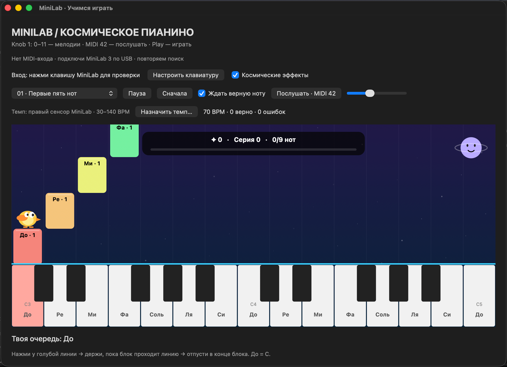

# MiniLab Piano

Небольшой тренажёр для macOS с падающими нотами, MIDI-входом и звуком пианино.
Вдохновлён механикой Synthesia; самостоятельная первая версия, не полная копия продукта.



## Запуск

Откройте `dist/MiniLab Piano.app`. Подключите MiniLab 3 по USB: MIDI-источники появятся вверху окна автоматически.
Выберите упражнение и нажмите «Начать». Играйте, когда нижний край блока касается голубой линии.
В режиме «Ждать верную ноту» движение остановится до правильного нажатия.
«Послушать» или MIDI 42 проигрывает выбранную мелодию целиком с правильными длительностями. Затем приложение автоматически возвращается к началу для самостоятельной игры — нажмите Play. Во время образца экранная кнопка позволяет остановить его.
Ползунок меняет темп от 30 до 140 BPM. Можно также нажимать экранные клавиши мышью.

По умолчанию экран показывает все 25 клавиш MIDI 48–72 (C3–C5), а упражнения играются в этом диапазоне.
Если диапазон MiniLab отличается, нажмите «Настроить клавиатуру», затем самое левое До (C)
на физической клавиатуре. Экран и упражнения переместятся вместе. Настройка действует до закрытия приложения.

Включены 12 мелодий и упражнений: первые пять нот, «Ода к радости», «Мерцай, звёздочка», гамма До мажор, «У Мэри был барашек», «Братец Яков», «Лондонский мост», «Горячие булочки», «Колокольчики» и три авторских упражнения «Лесенка», «Музыкальное эхо», «Прыгающий мяч».
Пока нет импорта MIDI-файлов, сохранения результатов, педали и отдельных партий двух рук.

## Сборка и проверка

Нужны macOS и установленный Swift / Xcode Command Line Tools. Сторонние зависимости не используются.

```sh
./build.sh
"dist/MiniLab Piano.app/Contents/MacOS/MiniLabPiano" --self-test
```

Проверяются последовательности уроков и MIDI-парсер, включая разделённые сообщения,
running status, Note Off и служебные MIDI-сообщения. Для проверки физической клавиатуры и звука
нужна ручная игра. Звук использует встроенный в macOS банк инструментов.

## Если клавиши не реагируют

Вверху должно быть «Подключено · Minilab3 MIDI». Приложение проверяет порты каждые две секунды
и повторяет подключение при временной ошибке CoreMIDI. Для MiniLab используется основной порт MIDI;
служебные DIN THRU, MCU/HUI и ALV исключены. MIDI-потоки разных устройств разбираются отдельно.

При нажатии строка «Вход» показывает название и MIDI-номер ноты даже без запуска урока.
Если нота вне показанного диапазона, приложение предлагает настроить клавиатуру.
Ошибки открытия клиента/порта и подключения выводятся в строке состояния.
На macOS MiniLab 3 работает без отдельного драйвера (USB class-compliant).

## Кнопки MiniLab

MIDI-нота 41 запускает или продолжает упражнение, MIDI-нота 40 ставит его на паузу, MIDI-нота 42 запускает прослушивание образца.
Эти сообщения используются как команды и не звучат как ноты. Отпускание кнопки не меняет режим.

## Космическое пианино

Цветные ноты, мерцающие звёзды, спутник, искры и волны на правильных нотах.
За каждую правильную ноту начисляются очки, серия даёт дополнительный бонус.
Ошибка сбрасывает текущую серию, но сохраняет очки и лучший результат серии в этом упражнении.
В конце — карточка с результатом, 1–3 звёздами за сыгранные ноты и конфетти.
Шкала показывает продвижение по уроку. «Сначала» сбрасывает результат текущей попытки.
Галочка «Космические эффекты» отключает фоновые и праздничные эффекты.
При системном «Уменьшении движения» мерцание, движение спутника и частицы отключаются автоматически.

## Длительность нот

Высота блока теперь равна длительности ноты: ½, 1, 1½ или 2 доли.
«Ода к радости» содержит пунктирный ритм (1½ + ½) и длинные окончания фраз;
в «Мерцай, звёздочка» окончания фраз длятся две доли.
В учебных упражнениях чередуются короткие и длинные ноты.

Нажмите клавишу при касании блока голубой линии, удерживайте до его верхнего края
и отпустите. На клавише заполняется индикатор, строка подсказки показывает оставшееся время.
Очки начисляются после правильного отпускания, с небольшим допуском для живой игры.
При раннем отпускании нота пропускается без очков. В режиме ожидания можно сразу играть следующую. В конце её длительности
этот режим останавливает время и ждёт отпускания. Без ожидания слишком позднее отпускание
также считается ошибкой. Пауза возвращает незавершённую ноту к началу для повторной игры.
Демо проигрывает новые длительности и повторно атакует одинаковые соседние ноты.

## Темп с MiniLab

Правый сенсорный ползунок (Modulation, по умолчанию MIDI CC 1) управляет темпом 30–140 BPM:
снизу медленнее, сверху быстрее. Экранный ползунок и число BPM обновляются одновременно.
Темп меняется без перезапуска урока; оставшееся время удержания пересчитывается по новому темпу.
Левый сенсор Pitch Bend для темпа не используется, поскольку он возвращается в центр при отпускании.

Чтобы выбрать другой регулятор, нажмите «Назначить темп…» и подвигайте нужный сенсор,
физический ползунок или другой регулятор, отправляющий абсолютные CC-значения 0–127.
Номер CC сохраняется между запусками. Кнопка «Отмена» отменяет ожидание назначения.
Относительные энкодеры и NRPN в этом режиме не поддерживаются.

## Выбор мелодий с Knob 1

Выбранная пользователем крутилка Knob 1 (фактически MIDI CC 16, подтверждено живой диагностикой)
выбирает мелодии: вращение вправо двигает по списку вперёд, влево — назад.
Значение регулятора прямо соответствует номеру песни: 0 — первая, 1 — вторая, …, 11 — двенадцатая.
Значения 12–127 оставляют выбранной последнюю мелодию. В строке входа отображаются значение, номер и название.
Смена мелодии останавливает упражнение и возвращает его к началу.
Затем нажмите MIDI 42 для образца или MIDI 41 (Play), чтобы играть.
CC 16 зарезервирован для выбора мелодий и не назначается на темп.

## Птичка на падающих нотах

Птичка встроена в основное учебное поле. Отдельного окна нет.
Она садится на верхний край нужного падающего блока и спускается вместе с ним.
Правильное нажатие вызывает прыжок и взмахи крыльев, удержание сохраняет полёт.
После завершения ноты птичка перелетает по дуге к следующему блоку — влево или вправо,
в зависимости от нужной клавиши. При раннем отпускании следует дальше без очков.
В режиме «Послушать» проходит мелодию сама. Пауза замораживает движение.
Клавиатура, длительности, очки, подсказки и управление MiniLab сохранены.
Галочка эффектов и системное «Уменьшение движения» отключают прыжки и взмахи.

## Плавные переходы между нотами

Следующую правильную клавишу можно нажать, ещё удерживая предыдущую.
Если предыдущая нота выдержана, она засчитывается, а следующая начинает удержание.
Если переход произошёл слишком рано, предыдущая пропускается без очков, но следующая принимается.
Отпускание предыдущей клавиши не прерывает новую ноту. В режиме без ожидания
переход принимается в пределах обычного допуска по времени у начала следующей ноты.

### Ошибки и птичка

Ошибки считаются за текущую попытку: первая не меняет внешность, вторая добавляет
мультяшный фингал под одним глазом, третья — под вторым. После четвёртой ошибки
птичка машет крыльями и улетает за границу поля. Урок и начисление очков продолжаются.
Пауза останавливает улёт; «Сначала», новая мелодия или новая попытка возвращают птичку.
При отключённых анимациях после четвёртой ошибки птичка скрывается сразу.

Три правильно выдержанные ноты подряд снимают оба фингала и возвращают улетевшую
птичку плавным прилётом. Счётчик ошибок птички после этого начинается с нуля.
Любая ошибка прерывает серию восстановления. Общие ошибки, очки и продвижение
по уроку при восстановлении сохраняются.

## Intel Mac

Отдельная версия для процессоров Intel: `dist/MiniLab Piano Intel.app`.
Для переноса на другой Mac используйте архив `dist/MiniLab-Piano-Intel.zip`,
распакуйте его и перенесите приложение в «Программы».
Требуется macOS 13 Ventura или новее. MIDI, звук и все игровые функции одинаковы.

Сборка Intel-версии возможна и на Apple Silicon:

```sh
./build.sh --intel
```

По умолчанию `./build.sh` собирает приложение для архитектуры текущего Mac,
также с минимальной версией macOS 13. Проверить Intel-версию на Apple Silicon
можно через Rosetta, если она уже установлена:

```sh
arch -x86_64 "dist/MiniLab Piano Intel.app/Contents/MacOS/MiniLabPiano" --self-test
```

### Сборка для Intel iMac с Sonoma 14.4

`./build.sh --sonoma` использует установленный Swift из Command Line Tools и SDK macOS 14,
вместо новейшего SDK из Xcode. Результат: `dist/MiniLab Piano Intel Sonoma.app` (x86_64, минимум macOS 14.0).
Архив для переноса: `dist/MiniLab-Piano-Intel-Sonoma.zip`; содержит приложение, README и Check.command.
При неудачном запуске Check.command сохраняет архитектуру, версию ОС, результат проверки подписи,
оценку macOS и вывод встроенных тестов в diagnostics.txt. Защита macOS при этом не изменяется.
Проверено: подпись и права исполнения после распаковки ZIP, тесты Intel-бинарника через Rosetta.
Физическая macOS 14.4 для проверки недоступна.
